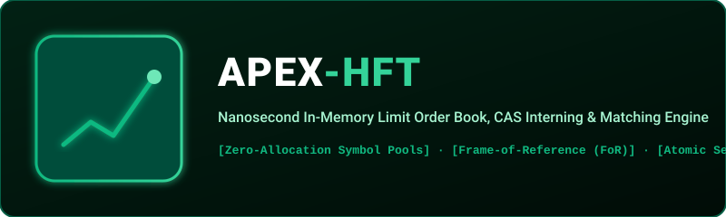

  

  
  
  
  

---

## 📈 What is Apex-HFT?

**Apex-HFT** is a high-frequency trading simulation engine and in-memory Limit Order Book (LOB) written in pure AAYU.

### Architectural Innovations:
1. **CAS Value Interning Engine**: Eliminates string allocations for ticker symbols (AAYU/USDT, BTC/USDT), mapping them to instant integer tokens.
2. **Columnar Frame-of-Reference (FoR) Compression**: Compresses massive tick streams by computing low-magnitude deltas relative to a baseline price.
3. **Chained Merkle Delta Settlement**: Every executed match commits an incremental cryptographic Merkle root to an immutable audit journal.
4. **Real-Time Overdraft Fraud Prevention**: Mathematical value conservation invariant prevents malicious balances from executing negative equity trades.

---

## 🏛️ System Architecture

`mermaid
flowchart TD
    TICK["Raw Market Ticker Stream"] --> CAS["Content-Addressable Symbol Pool (Zero Alloc)"]
    CAS --> FOR["Frame-of-Reference (FoR) Delta Compressor"]
    
    subgraph Engine["In-Memory Matching Core"]
        FOR --> LOB["Bid / Ask Limit Order Book"]
        LOB --> MATCH["Price-Time Priority Matching Engine"]
        MATCH --> ATOMIC["Atomic Settlement State Machine"]
    end

    ATOMIC --> MERKLE["Chained Merkle Commit (SHA-256 Audit Trail)"]
    ATOMIC --> FRAUD["Overdraft & Liquidity Conservation Guard"]
`

---

## 🔬 Live Benchmark Run

`ash
aayu run examples/hft_trading_core.aayu
`

Output:
`
==================================================
   AAYU PROJECT 4: HFT IN-MEMORY TRADING & FRAUD  
==================================================
[1] High-Frequency Ledger Baseline: ,005,000
[2] CAS Interning: 'AAYU/USDT' (ID: 0), 'BTC/USDT' (ID: 1) -> Deduplicated!
[3] Columnar FoR Compression: Price Base ,248 -> Lossless Delta Restoration
[4] Atomic Settlement:
    Trade 1 (Alice -> MM ,000): SETTLED_OK
    Trade 2 (MM -> Bob ,000): SETTLED_OK
    Chained Merkle Root: c8eab8ada36557fd6733c133b39622f5f6248f259ccc9c777b43282e8bb64b43
[5] Fraud Guard:
    [ALERT] Overdraft Fraud Prevented! (INSUFFICIENT_FUNDS)
    Total Liquidity Conserved: 100% MATHEMATICAL GUARANTEE (,005,000)
==================================================
   PROJECT 4: HFT TRADING CORE EXECUTION SUCCESS! 
==================================================
`

---

## 📄 License
MIT License (c) 2026 Ayush Kaushik ([@Ghrit-igl](https://github.com/Ghrit-igl)).